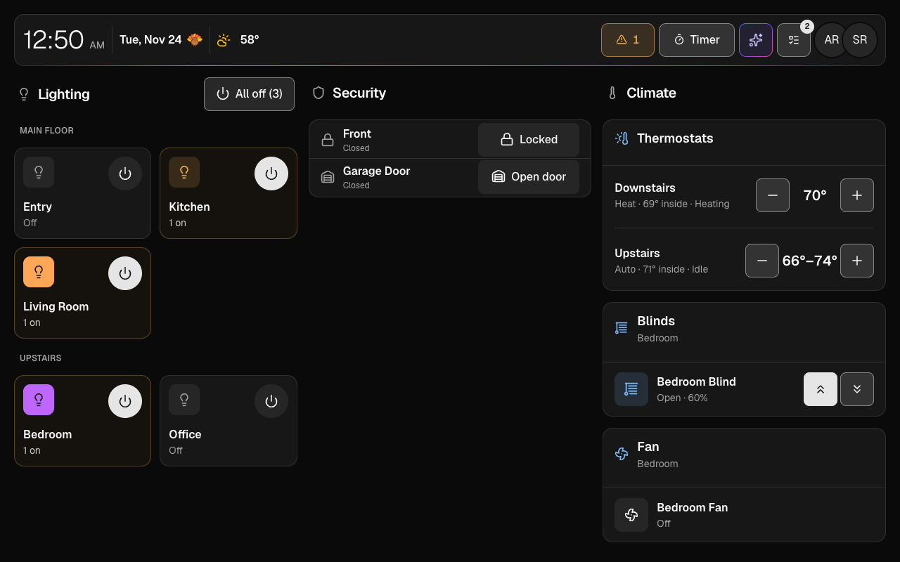

# The cards

The dashboards are made to replace Home Assistant's own interface, and the two cards below are whole
dashboards: put one in a `panel: true` view, alone. For a house that only wants a part of them, the
[section cards](#section-cards-your-own-layout) are the same parts one at a time, to place among its own
cards.

## `custom:home-dashboard`

For desktops, laptops and phones (the Companion app included).


- **Wide screens** (1024px and up): the header over Lighting, Security and Climate side by side,
  each column scrolling on its own. The header has three parts: the status (time, date, weather, and
  chips for open doors, notices and laundry only while there are some), who's home (people and pets),
  and three quick actions, Assist, Cameras and Music (after a panel's Timer), with To-do, Daily,
  Messages, TVs and Energy in More, which shows the to-do count.
- **Lighting is rooms first**: a tile per room, by floor (what's on, its scene), in equal columns.
  A tap on a room opens it: its lights' switch at the top, then its scenes, colors, bedtime and a row
  per light; a light that's off shows only its name until it's on.
- **Security is the alarm, then doors and garage doors**: the alarm's state at a glance (its Disarm
  quiet while the house is safe, red only while it's going off), then a row per door and garage door
  with its state in words (amber only when something's open or unlocked) and a button saying what a
  tap does (Unlock, Lock, Open, Close).
- **Climate is a line per thing**: each thermostat zone (its mode, the temperature inside, the
  setpoint between − and +; a tap opens its mode), scent diffuser (on or off and the fragrance, Quick
  scent), curtain (open and close as icons, Open all / Close all for several; a tap opens its
  position) and fan (a switch; a tap opens its speed, Oscillate and presets).
- **Phones and portrait tablets**: a header with the greeting, weather and the house's status, and
  a tab bar: Lights, Security, Assist (the voice button, in the middle), Climate, Music. Cameras
  open from Security.
- Home Assistant's toolbar is hidden (the card's header has a button for the sidebar).
- No scrollbars: lists and columns scroll by touch, wheel or keyboard without a bar, and the page's
  own is hidden while a dashboard is on it.
- Links: `?view=security` (or `lights`, `climate`, `music`, `cameras`) opens a tab, `?camera=<entity>`
  opens a camera, `?brief=1` the daily brief, `?todo=<list>&item=<uid>` a to-do item.

| Option | | |
| :--- | :--- | :--- |
| `color_scheme` | `auto` (default), `light`, `dark` | `auto` follows Home Assistant's theme mode; the card's Appearance dialog sets that |
| `theme` | a theme id | This dashboard in that theme whatever's picked ([Themes](themes.md)) |
| `motion` | `full`, `reduced` | `reduced` for a device that struggles: numbers change without rolling, nothing spins or pulses, dialogs don't slide. Else the integration's Animations option (General), `full` by default; a device set to reduce motion always gets less |
| `house` | see below | House settings, over the integration's |

## `custom:wall-panel-dashboard`

For a tablet on the wall. See [Wall panels](wall-panels.md).



| Option | | |
| :--- | :--- | :--- |
| `name` | text | The panel's name ("Kitchen wall panel"): where an alarm was armed or disarmed when the tablet's user is shared |
| `floor` | a floor id | Its floor's lights first |
| `timer` | `true` | A countdown timer in the header, announced on the house's speaker when it ends |
| `color_scheme` | `dark` (default), `light`, `auto` | |
| `theme` | a theme id | This panel in that theme ([Themes](themes.md)) |
| `motion` | `full`, `reduced` | `reduced` for a tablet that struggles, as for the Home card |
| `house` | see below | |

## Section cards: your own layout

The whole dashboards above are the way to use them; for a dashboard of your own that only wants some
parts, each part is also a card, for Home Assistant's **sections** view (or any view), beside any other card. Edit a dashboard → **Add card** →
**By card**, and search for *Raineworks*; Home Assistant shows each with a live preview.

| Card | | Options |
| :--- | :--- | :--- |
| `custom:raineworks-header` | The clock, weather, who's home and what the house is doing, with the daily brief, messages, to-dos and TVs a tap away: the wall panels' header where the card is about 1000px wide or more (a section spanning the view), the phone's narrower | |
| `custom:raineworks-lighting` | Every light and scene by floor and room | `title` (default Lighting); `floor`: a floor id whose rooms come first (without one, every floor, top first) |
| `custom:raineworks-security` | The alarm, locks with their doors, garage doors and the cameras | `cameras: false` leaves the cameras out (beside a Cameras card) |
| `custom:raineworks-climate` | Thermostats, scent diffusers, curtains and blinds, and fans | |
| `custom:raineworks-music` | Music Assistant: now playing, browse and search, the queue and speaker groups | |
| `custom:raineworks-cameras` | Every camera's snapshot, each opening its live view and clips | |

Every one also takes `color_scheme`, `theme`, `motion` and `house`, as the whole dashboards do.

```yaml
type: sections
max_columns: 3
sections:
  - type: grid
    column_span: 3
    cards:
      - type: custom:raineworks-header
  - type: grid
    cards:
      - type: custom:raineworks-lighting
        floor: main_floor
  - type: grid
    cards:
      - type: custom:raineworks-security
        cameras: false
      - type: custom:raineworks-cameras
  - type: grid
    cards:
      - type: custom:raineworks-climate
      - type: weather-forecast # any of Home Assistant's own cards, in between
        entity: weather.home
```

- **They fit their column.** A card lays itself out for its own width, not the screen's: Lighting in a
  phone-wide column on a desktop shows its rooms two across, as on a phone. Dialogs still open for the
  screen (centered on a desktop, a sheet from the bottom on a phone).
- **Home Assistant's own chrome stays**: its toolbar, sidebar and page scrolling, unlike the whole
  dashboards, and each card is as tall as its content.
- **Light on the page**: every card on it shares one parsed stylesheet, so the CSS is parsed and kept
  once however many cards there are.
- **Once per page**: the toasts (a door opened, the doorbell, the alarm), the doorbell's live view, the
  Assist glow and the connection banner come from one card, whichever is first on the page, however many
  there are.
- **A part this house hasn't** says so instead of showing nothing ("Music needs the Music Assistant
  integration"), as does one turned off in the house settings.

## The `house` settings

What discovery can't tell. Most are also in the integration's options ([reference](reference/options.md));
the card's `house` option wins key by key, so YAML can override a setting for one dashboard. Share
one file between your dashboards with `house: !include ../house.yaml`.

```yaml
house:
  announce_speaker: media_player.kitchen      # the kitchen timer, the daily brief's first pick
  weather: weather.home                       # else the first weather entity
  alarm_panel: alarm_control_panel.alarmo     # else Alarmo's, else the first
  thermostats:                                # else every visible thermostat
    - entity: climate.main_floor
      name: Main Floor
  laundry:
    washer: { machine_state: sensor.washer_machine_state, job_state: sensor.washer_job_state, time_remaining: sensor.washer_completion_time }
    dryer: { machine_state: sensor.dryer_machine_state, job_state: sensor.dryer_job_state, time_remaining: sensor.dryer_completion_time }
  guest_wifi_qr: image.guest_wifi_qr_code     # the UniFi integration's QR code for the guest network
  birthday_calendar: calendar.birthdays       # else the calendar named "Birthdays"
  tts:
    engine: tts.home_voice                    # else the first tts entity
    voice: nova
    streaming: true                           # an engine that speaks while the answer is written
    fallback: tts.google_translate_en_com
  live_inputs:                                # inputs a speaker can play (a turntable), by Music Assistant URI
    - name: Turntable
      uri: sendspin_source://audio_source/turntable
      signal: binary_sensor.turntable_signal
  bedtime_routines:                           # a room's bedtime extras, beyond what its labels say
    switch.bedroom_bedtime:
      zone: Bedroom and Bath                    # else the room's own name
      steps:
        - { kind: fan, text: Turns the fan on, actions: [fan.turn_on] }
  modules:                                    # turn a feature off
    holidays: false
```

- Every key is optional. A value of the wrong shape is ignored, never an error, so check that what
  you set shows up.
- A bedtime step's `kind` sets its icon: `rooms`, `lights`, `media`, `speaker`, `fan`, `covers`,
  `locks`, `climate`, `alert` or `panels`. Its `actions` name the actions your automation runs, so a
  test can check the list stays true.
- Module ids are in [Modules](reference/modules.md).

## Bedtime

Each room's bedtime (the integration's Bedtime switches) and Home Bedtime turn things off by label,
so a new lamp, TV or speaker joins bedtime once it's labeled and in its room:

| Label | At bedtime |
| :--- | :--- |
| **Household Light** (`household_light`) | Turned off |
| **Household TV** (`household_tv`) | Turned off |
| **Household Speaker** (`household_speaker`) | Its music stopped |
| **Stays on at bedtime** (`stays_on_at_bedtime`) | Left alone, and turning it on in a room in bedtime doesn't ask first (a night light, a TV with a sleep timer) |

A room's bedtime covers what's in its own area (and closes its curtains and blinds); Home Bedtime
covers the whole house. What a room's routine does beyond that (a fan turned on, a speaker in the
next room) goes in `bedtime_routines`, so its confirm dialog lists it too. The routines themselves
are your own automations, triggered by the Bedtime switches; the dialog lists the labeled things
from the same labels the automations use.
